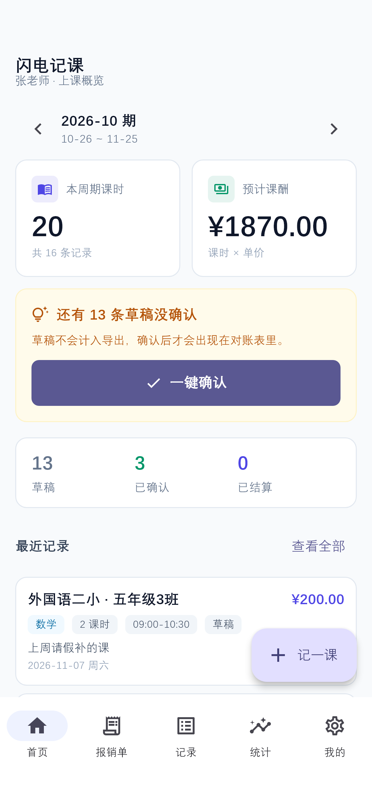
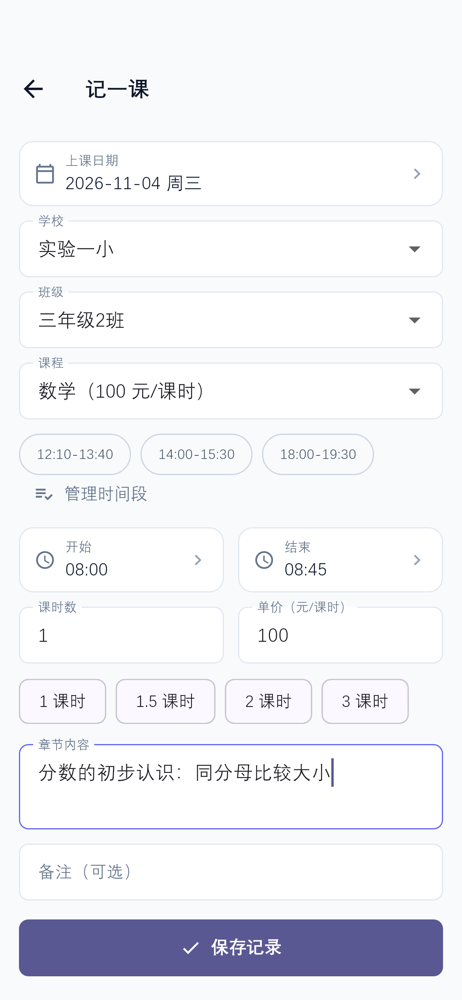
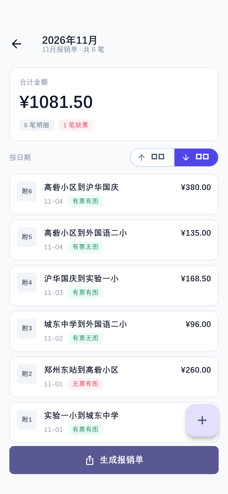
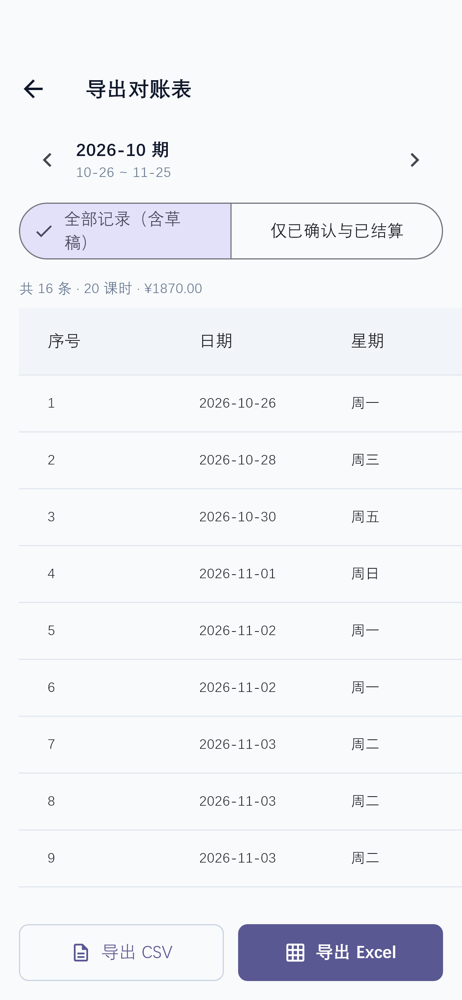

# 闪电记课

> 面向培训教师 / 家教 / 课外辅导从业者的**课时记账 + 报销单** Android 应用。
> 完全离线：不注册账号、不申请任何系统权限、不联网，数据只存在用户自己的手机上。

  
  
  
  

- **下载**：[Releases](../../releases)（Android APK · v1.0.0）
- **使用说明**：[docs/user-guide.md](docs/user-guide.md)（含全流程截图）
- **隐私政策**：[store/privacy-policy.html](store/privacy-policy.html)
- **技术栈**：Flutter 3.47 · Dart 3.13 · Riverpod 2 · go_router 14 · 自研 tw 设计系统

## 它解决什么问题

辅导老师的两件麻烦事：

1. **课酬对不上**——课时散落在微信群聊天记录里，月底跟机构核对工资全靠翻记录。
   → 按老师自己的「结算周期」（如每月 26 号 → 次月 25 号）自动统计课时与课酬，导出对账表直接和公司核。
2. **报销单手工填**——跑课的打车费要按机构的 Excel 模板手填月份、编号、贴截图，附号一错全表对不上。
   → 只录明细（日期、行程、金额、票据状态），按日期自动归档成月度报销单，一键生成**带凭证截图**的 xlsx，微信发财务即可。

## 功能一览

| 模块 | 能力 |
|---|---|
| 记课 | 学校 → 班级 → 课程三级联动，选课程自动带单价（可按学校覆盖）；常用时间段一键选；0.5 步进课时 |
| 状态流转 | 草稿 → 已确认 → 已结算；**已结算锁定不可改**，防止对完账两边数字对不上 |
| 首页 | 结算周期课时 / 课酬概览、草稿提醒与一键确认、最近记录 |
| 统计 | 按学校 / 课程 / 班级三维度看课时与金额分布 |
| 报销单 | 无需「新建报销单」，录明细即按日期自动归档；附号由导出顺序生成，屏幕与 Excel 永远对得上；无票明细整行标红 |
| 导出 | 课时对账表（CSV / Excel）、月度报销单（xlsx 内嵌凭证图）、全量备份（zip 含截图） |
| 课程表 | 日 / 周 / 月三视图，由上课记录驱动，可一键生成上课记录 |

## 隐私与安全

- 主 manifest **零 `uses-permission`**，未声明 `INTERNET`——从操作系统层面就无法联网；
- 数据单文件本地存储（临时文件 + rename 原子替换），备份即一份 zip；
- 首启隐私政策拦截，应用内可随时查阅全文；卸载即彻底删除全部数据。

## 质量保障

- `flutter analyze` 无告警；
- 101 个单元 / widget 测试覆盖：结算周期、统计聚合、报销归档与附号稳定性、导出表构建、课程表合并、首启隐私拦截合规用例（未同意不露真实界面、清空数据 ≠ 撤销同意、导入老备份不冲掉本机同意）。

## 关于源码

本项目源码暂未公开，欢迎通过 [Issues](../../issues) 反馈使用问题。页面均由真实应用流程截取，效果以 Release 包实际体验为准。

---

© 2026 zhangfengyao01 · 应用包名 `cn.shanshanjike.ledger`
