# 闪电记课 · 产品使用说明

> 版本 1.0 · 更新日期 2026-11-04
>
> 「闪电记课」是一款给培训教师 / 家教 / 课外辅导从业者用的**课时记账 + 报销单**手账工具。
> 它完全离线运行：不注册账号、不申请系统权限、不联网，你的课时记录和凭证截图只存在你自己的手机上。

本文截图均按真实使用流程截取（演示数据为内置示例，见附录）。

---

## 1. 第一次打开

首次启动会先看到隐私政策同意页。页面用最短的话讲清楚三件事：

- 本应用不申请任何系统权限，也不具备联网能力；
- 课时记录与凭证截图只保存在手机上，不经过任何服务器；
- 随时可以在「我的 → 隐私政策」查看完整条款。

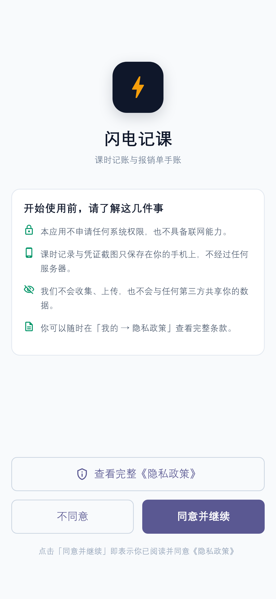

- 点 **「同意并继续」** 进入应用（同意时间会被记录，之后不再打扰）；
- 点 **「查看完整《隐私政策》」** 可先读全文再决定；
- 点 **「不同意」** 会给出二次确认，不同意则无法使用。

## 2. 开始前的一次性设置

先花两分钟把「地基」打好，之后记课只需要点几下。

### 2.1 基本信息（我的 Tab）

底部导航第 5 个 Tab「我的」：

- **老师姓名**：会显示在首页顶部（如「张老师 · 上课概览」），导出的对账表里也会带上；
- **默认课时数 / 默认开始 / 默认结束**：记一课时自动预填，减少输入；
- 姓名和课时数改动后点 **「保存设置」**；默认上课时间是**选完立即生效**，不用点保存。

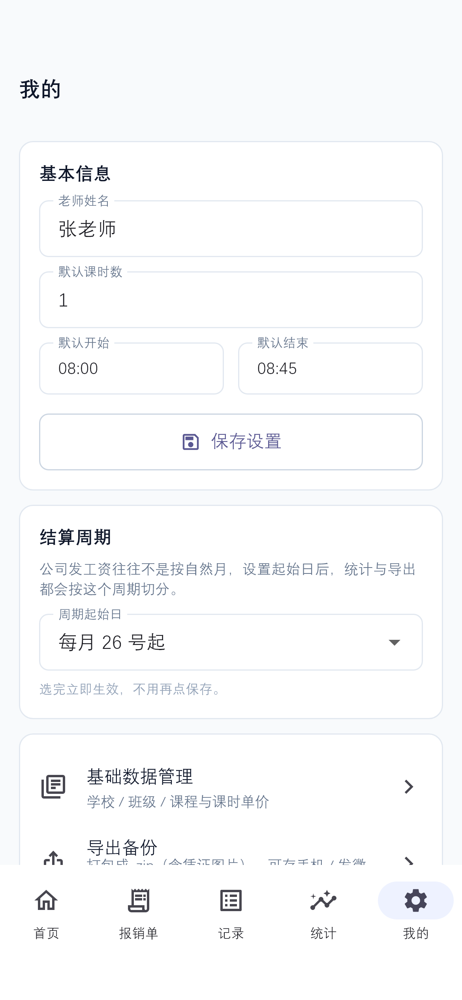

### 2.2 结算周期

公司发工资往往不是按自然月。在「结算周期」里把**起始日**设成公司的账期（例如每月 26 号起），首页、记录、统计、导出就都会按「26 号 → 次月 25 号」切分周期，**选完立即生效**。

### 2.3 基础数据：学校 / 班级 / 课程

「我的 → 基础数据管理」，三个 Tab 分别维护：

- **学校**：如「实验一小」「外国语二小」；
- **班级**：挂在某个学校下面，如「三年级2班」；
- **课程**：设好**课时单价**（如数学 100 元/课时）。如果某个学校的单价不一样（比如英语在二小是 100 元），直接在课程里按学校覆盖单价。

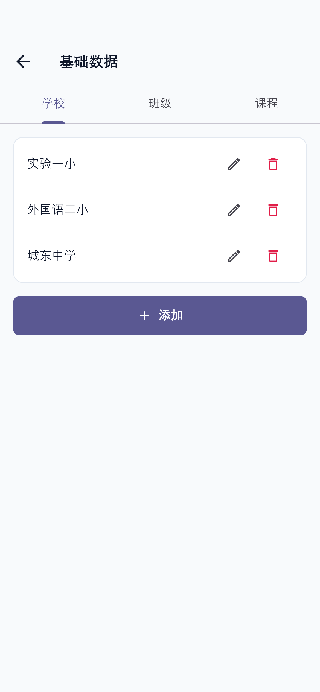

> 想删学校/班级/课程时，如果它已经被记录引用过，应用会拒绝删除，避免留下对不上号的旧数据。

## 3. 日常记录：记一课

任何页面点右下角 **「记一课」**（首页底部也有「记一课」按钮）：

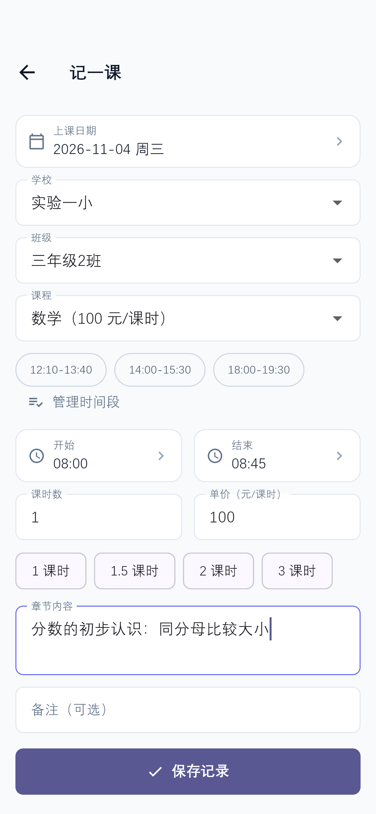

1. **上课日期**：默认今天，点一下可改；
2. **学校 → 班级 → 课程**：三级联动下拉，选完课程自动带出单价；
3. **时间段**：常用时段一键选（12:10-13:40 等），也可以点「管理时间段」维护自己的常用时段；下面的「开始 / 结束」可精确调整；
4. **课时数**：支持 0.5 步进，也有「1 / 1.5 / 2 / 3 课时」快捷 chips；
5. **单价（元/课时）**：自动带出，可临时改；
6. **章节内容 / 备注**：选填，章节内容会进导出表，也支持搜索。

保存后记录以 **草稿** 状态存在，核对无误后再确认。

## 4. 一眼看全局：首页 / 记录 / 统计

### 4.1 首页

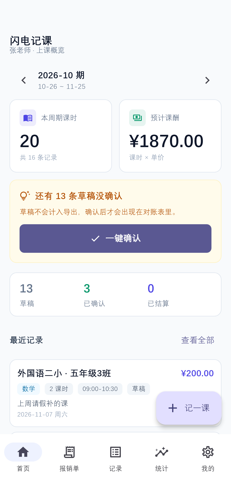

- 顶部**周期切换**（‹ ›），默认显示当前结算周期；
- 两张关键数字卡：**本周期课时**、**预计课酬**（课时 × 单价）；
- 有未核对的记录时会出现**橙色提醒卡**：*「还有 N 条草稿没确认」*，点 **「一键确认」** 全部转为已确认；
- 下方是状态分布（草稿 / 已确认 / 已结算）和最近 5 条记录。

### 4.2 上课记录

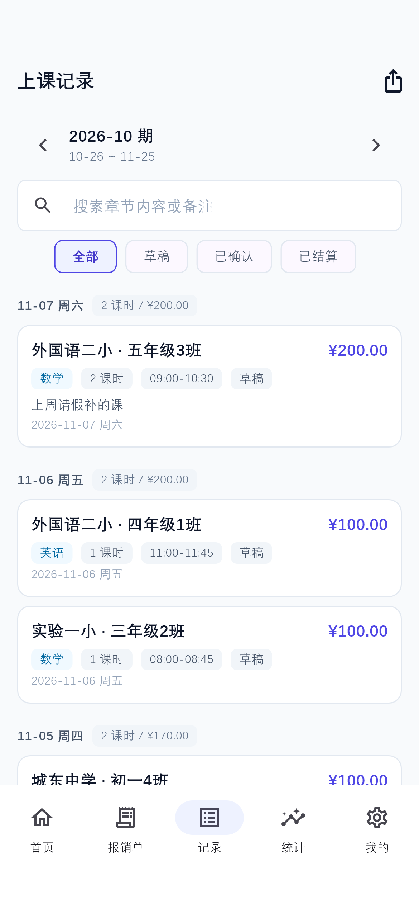

按日期倒序分组展示，顶部可以**搜索章节内容或备注**，并按 **全部 / 草稿 / 已确认 / 已结算** 筛选。点任意一条进详情，可改状态、编辑或复制（「上周同样的课再来一遍」）。

### 4.3 统计

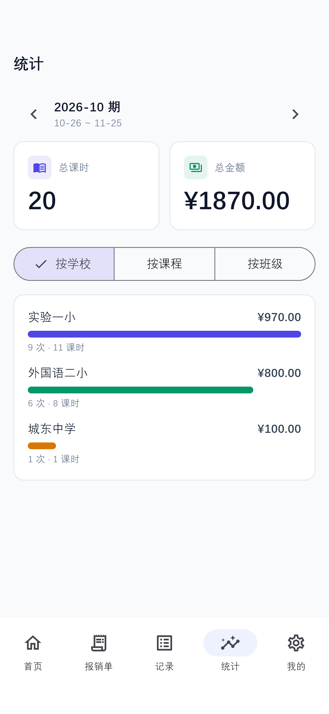

按 **学校 / 课程 / 班级** 三个维度看本周期的课时与金额分布，条形长度直观对比。

## 5. 报销单：从跑腿票到交给财务的 Excel

报销单模块是第 2 个 Tab。**没有「新建报销单」这一步**——你只管录明细，明细按日期自动归档成「一个月一张单」，从根上避免「3 月的表装 9 月的数据」。

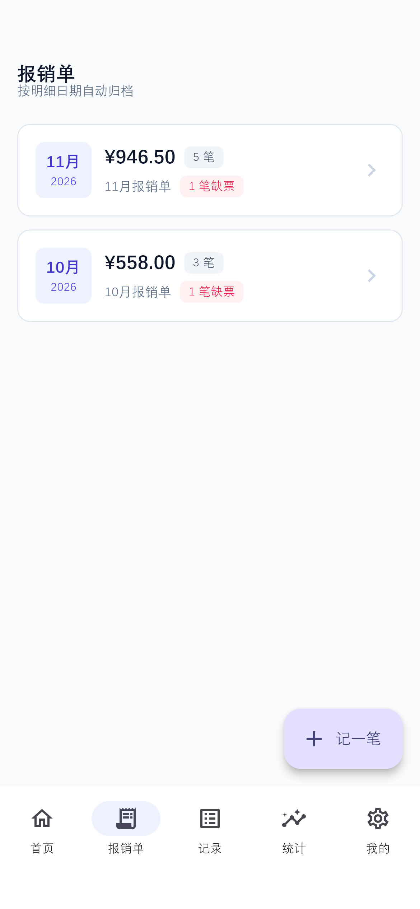

每张月份卡片显示：合计金额、笔数、sheet 名（如「11月报销单」），有缺票明细时还会标红提示「N 笔缺票」。

### 5.1 记一笔

点右下角 **「记一笔」**：

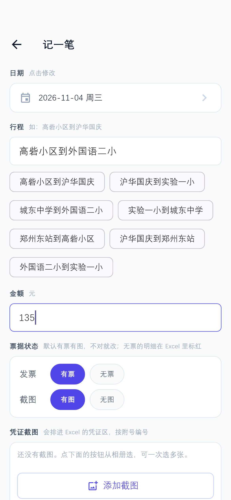

| 字段 | 说明 |
| --- | --- |
| 日期 | 默认今天，点一下可改 |
| 行程 | 如「高砦小区到沪华国庆」；**历史行程会变成快捷 chip**，点一下就填上 |
| 金额 | 必填，需大于 0 |
| 票据状态 | **默认「有票有图」**，不对再改；无票的明细在导出的 Excel 里会标红 |
| 凭证截图 | 可一次选多张，会排进 Excel 的凭证区并按附号编号 |
| 备注 | 选填 |

> **小贴士**：选了「有图」但没挂截图直接保存，应用不会拦你——会自动按「无图」记录并提示 *「没添加截图，已按「无图」保存」*，保证存下来的状态永远和实际凭证一致。
>
> 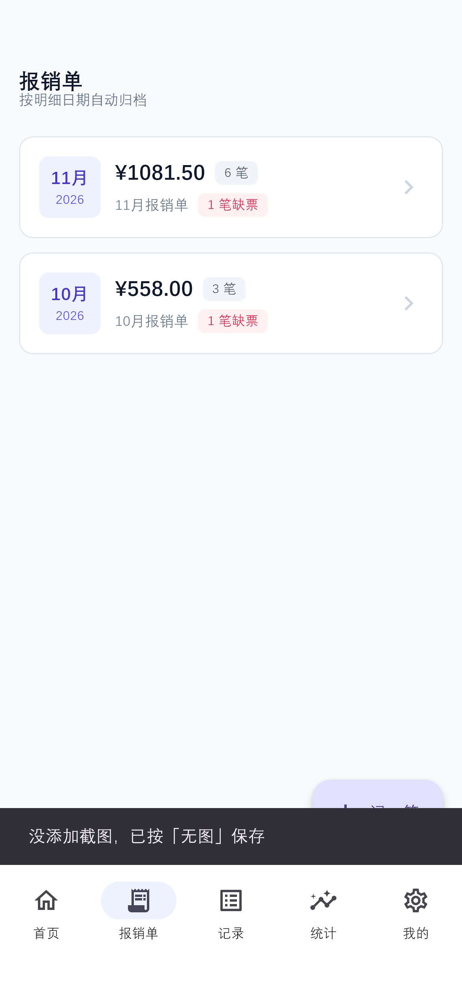

### 5.2 报销单详情与排序

点月份卡片进入详情。顶部是**合计金额**卡片，下方有 **「按日期 升序 / 降序」** 切换，**默认降序**（刚记的排最上面，翻账先看到最近的）。

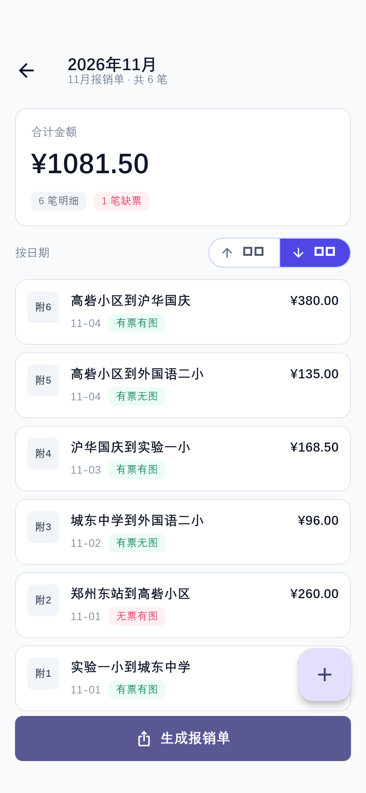

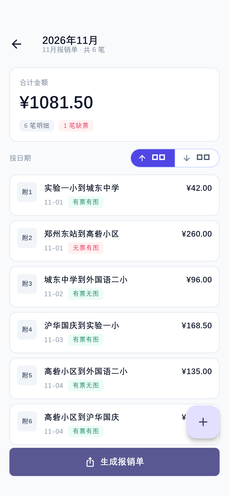

> **注意**：切换排序**只改屏幕上的显示顺序，不改附号**。附号（附1、附2…）锚定的是日期升序，也就是导出 Excel 里凭证区的编号——这样你屏幕上的「附3」和财务手里那张表的「附3」永远是同一条。

### 5.3 生成报销单

详情页底部点 **「生成报销单」**，应用会：

1. 生成一个 xlsx（sheet 名就是月份，如「11月」）；
2. 明细区按日期升序编号，每条带附号；
3. **凭证截图直接嵌进 Excel 的凭证区**，按附号排列；
4. **无票的明细整行标红**，财务一眼能看出哪些要补；
5. 生成完直接调起系统分享——微信发给财务即可。

## 6. 课时对账表导出

「记录」Tab 右上角的分享图标（或从首页进入）打开「导出对账表」：

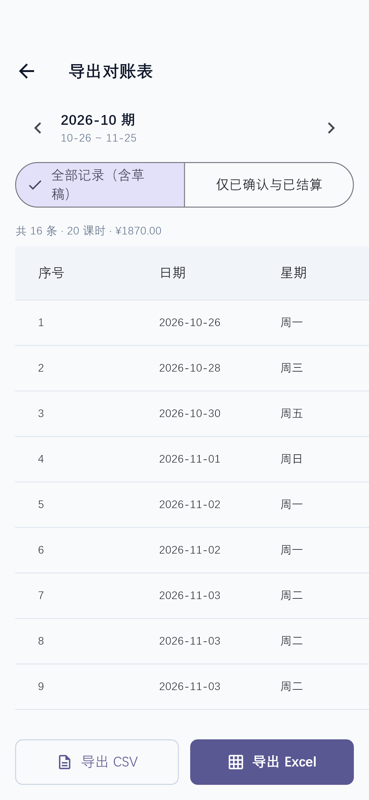

- **范围**：`全部记录（含草稿）` 或 `仅已确认与已结算`——对账给公司时选后者；
- 中间是**所见即所得的预览**：序号、日期、星期、学校、班级、课程、课时、单价、金额、章节……
- 底部 **「导出 CSV」**（通用、任何表格软件能开）或 **「导出 Excel」**（xlsx，格式更好看）。

## 7. 数据安全：备份 / 恢复 / 清空

「我的」页里：

- **导出备份**：打包成 `.zip`（业务数据 + 全部凭证截图），可存手机、发微信文件或邮件；
- **从备份恢复**：优先「从文件导入」（推荐，选 `.zip` 或老的 `.json`），也可以「粘贴 JSON 文本」兜底；导入是先校验再覆盖，坏文件不会弄脏现有数据；
- **清空全部数据**：二次确认后清空，**不会**撤销你的隐私同意，也不会误删 App 本身。

换手机的推荐流程：旧手机「导出备份」→ 把 zip 发给自己 → 新手机安装 → 「从备份恢复 → 从文件导入」→ 数据（含凭证图）完整回来。

## 8. 隐私政策

「我的 → 隐私政策」可以随时查看应用内全文（商店审核也走这里）：

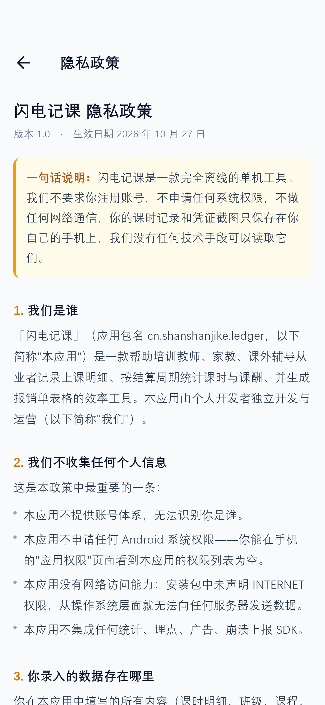

一句话版本：**不注册、不联网、不要权限，数据只在你手机上**。应用没有任何技术手段读取你的记录；卸载应用即彻底删除全部数据。

## 附录 A · 记录状态的流转

| 状态 | 含义 | 计入导出 | 可编辑 |
| --- | --- | --- | --- |
| 草稿 | 刚记下，还没核对 | 否（默认不含） | 是 |
| 已确认 | 核对过了，纳入统计与导出 | 是 | 是 |
| 已结算 | 公司已结账 | 是 | **否**（锁定，防止对完账两边数字对不上） |

流转方向：草稿 → 已确认 → 已结算。

## 附录 B · 本文截图对应的演示数据

截图使用应用内置的示例数据（首次安装自动生成，可在「我的 → 清空全部数据」归零）：

- 3 所学校、5 个班级、3 门课程（数学 100 / 英语 90 / 科学 70 元/课时）；
- 最近两周共 16 条上课记录（含草稿与已结算）；
- 报销明细跨 10 月与 11 月，共 9 条，其中 2 条无票。

截图由脚本 `test/tools/render_screens.dart` 驱动**真实页面与真实路由**离屏渲染生成（`flutter test test/tools/render_screens.dart`，产物落在 `docs/screenshots/`），画面与真机一致，仅为方便排版。

## 附录 C · 常见问题

**Q：记错了能改吗？**
能。点开那条记录进详情即可编辑；只有「已结算」的记录是锁定的（对完账不能再改）。

**Q：附号会乱吗？**
不会。附号由导出顺序自动生成（第 1 条就是附1），页面上的排序切换不参与编号，永远和 Excel 对得上。

**Q：换手机/换设备数据怎么办？**
用「我的 → 导出备份」生成 zip，新手机上「从备份恢复 → 从文件导入」即可，凭证截图会一起回来。

**Q：为什么我导出的表里有的行是红的？**
红色 = 该明细无票，财务需要补票；这是有意为之的提醒，不是错误。

**Q：应用会偷跑流量吗？**
不会。安装包未声明 `INTERNET` 权限，从系统层面就无法联网；你可以在「应用权限」页看到权限列表为空。
